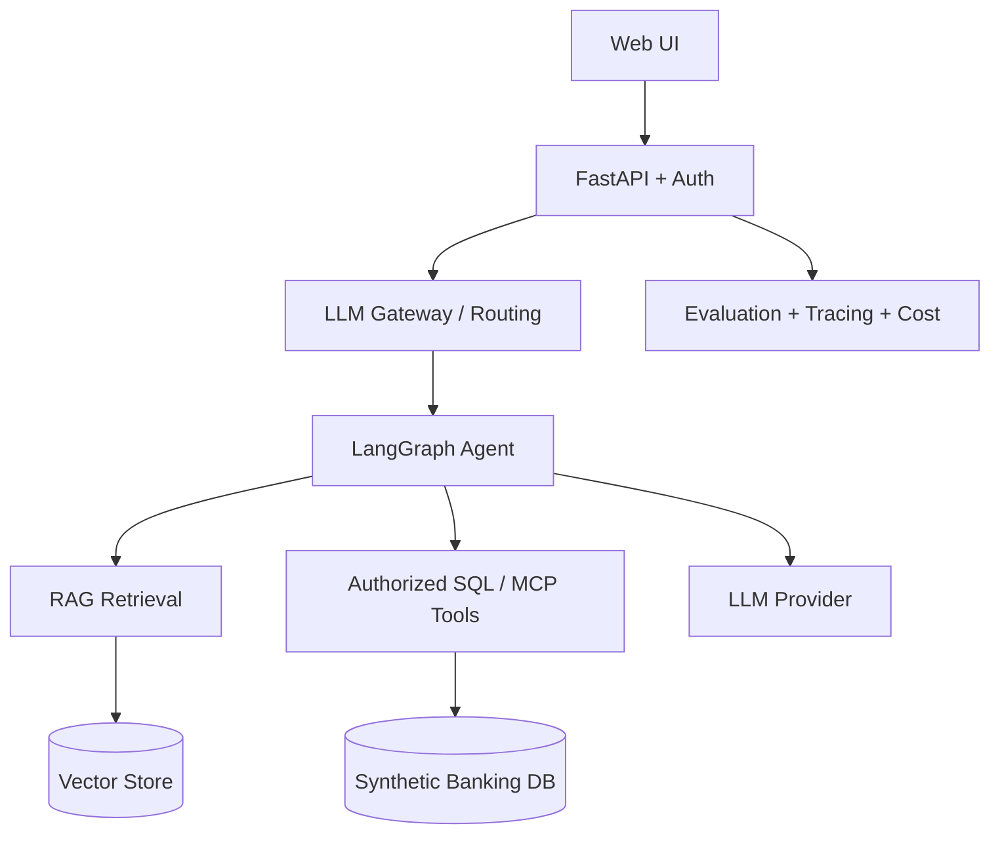

# Enterprise Agentic AI Architecture (planned)

## Day 1 implemented
- FastAPI health endpoint, synthetic account data endpoint, explicit placeholder question endpoint.
- Local test scaffolding and container configuration.

## Not yet implemented
- Authentication and authorization, actual RAG, agent planning, MCP, model routing, evaluation, monitoring and production hardening.

## Security decisions
- All accounts are fabricated. Never commit credentials or real customer data.
- Day 1 `/demo/accounts` is intentionally unauthenticated and must not be used for sensitive data.
- Future tools will be read-only and subject to per-user access controls.
